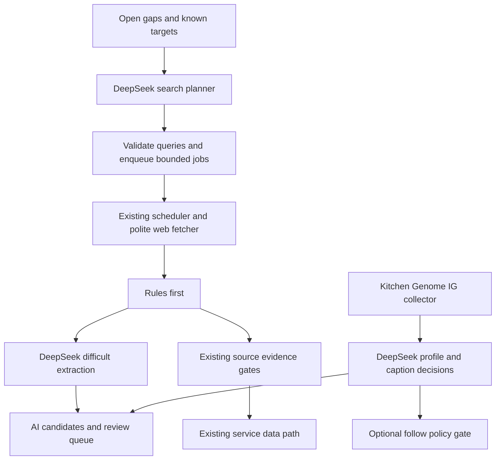

# DeepSeek collection design: web and @kitchen.genome

Status: DESIGN only. Owner order: 2026-11-05. Baseline: `main` at `8a2326a`.
This change adds only this document; all modules, configuration, migrations,
commands, and tests described below are proposed implementation work.

## 1. Scope and invariants

DeepSeek supplies bounded search plans and difficult extractions for web
collection, plus profile prioritization, extraction, and optional follow
recommendations for the dedicated `kitchen.genome` Instagram account. Local
Python daemons run the collection; no Grok Bot chat calls or Cursor CloudAgent.

- Every model-derived finding is `asserted_by=ai_inference`, pending human
  review. Source quality, model confidence, and agreement between models cannot
  promote it. It never automatically changes `data/seed.json`, service views,
  employment/status history, or site output.
- Every new Instagram finding, including deterministic keyword matches, is
  pending-only and cannot corroborate a publishable web finding.
- Web collection retains robots enforcement, stops on 403/429/503/challenge,
  at least 5 seconds per domain (longer robots delay wins), concurrency one per
  domain, depth at most 2, and daily ceilings of 500 candidate URLs and 200
  content fetches. These are ceilings, not collection targets.
- Instagram uses only its dedicated identity, at most 25 handles/day, at least
  8 seconds between **network requests**, at most 6 captions per handle/day,
  stored excerpts at most 40 characters, and at most 10 follow attempts/day.
  Checkpoint/challenge/429 stops the account immediately. No proxy, account
  swap, challenge solving, or automatic same-day relogin.
- Work proceeds on branches and PRs; squash merge is a later action. Never push
  to `main`. The future daily pipeline must stop at a reviewable PR.

## 2. Existing integration points and gaps

| Existing code | Observed behavior | Required design change |
| --- | --- | --- |
| `daemon/kg_daemon/stages.py::extraction` | Injectable `ai_extractor(doc, body)` stub; charges a fixed 1,000 tokens before each call | Bind a shared DeepSeek adapter, select difficult documents, preserve evidence locators, charge measured usage |
| `daemon/kg_collect/pipeline.py::process_doc` | Optional `model_hook` runs on ambiguous rule rows; forces `epistemic=inference` | Pass bounded source context and meter; validate model fields before persistence; queue reviews immediately |
| `daemon/kg_collect/cycle.py` | `Bot.model_hook` exists, but CLI does not supply it; stage plan uses deterministic discovery/gap jobs | Add DeepSeek planning and extraction adapters without replacing scheduler or polite fetcher |
| `daemon/kg_collect/gaps.py`, `apply.py`, `resolve.py` | Gap filling, application, and promotion largely require claim/fact evidence | Retain these gates and explicitly exclude model provenance at every boundary |
| `daemon/kg_daemon/collect_bridge.py` and `stages.py::extract_from_body` | Bridge carries inference in payload, but `_cand` defaults imported assertions to `source`; current-version filter assumes one extractor version | Preserve AI provenance and distinguish rule version from model/prompt version |
| `daemon/kg_daemon/runner.py::CostMeter` | Durable run ledger; charge checks cap; resume starts a new run | Add reservation/settlement and shared daily allowance so retries/resume cannot reset budgets |
| `crawler/instagram.py` | Agamajung identity/session/flag; delay at handle loop; run-local handle cap | Leave this module intact; build parallel `instagram_kg.py` with durable quotas and request-level throttling |
| `crawler/apply.py` | Reads `ig-*.json`; IG plus one reliable web host can auto-apply | New IG outputs must never enter this glob or its corroboration count; add defense-in-depth provenance rejection |
| `scripts/daily_pipeline.sh` | Runs legacy IG and collector; then applies/builds, broadly stages, pushes, immediately squash-merges, optionally deploys | Select KG account explicitly, emit statuses, isolate pending outputs, stop at PR creation |

The legacy registry describes `instagram_public` as paused. Its flag and session
remain untouched. The dedicated account is an owner-ordered identity change,
not a failover mechanism: a KG block must never invoke agamajung, or vice versa.

## 3. Components and data flow



Proposed modules:

- `daemon/kg_ai/deepseek.py`: thin shared HTTP client, bounded JSON handling,
  injectable transport/clock, sanitized errors, request identity and usage.
- `daemon/kg_ai/budget.py`: reservation adapter around existing `CostMeter` and
  shared daily accounting; no independent unmetered model calls.
- `daemon/kg_collect/deepseek.py`: gap planner and difficult-extraction adapter.
- `daemon/kg_daemon/deepseek.py`: adapter for the existing stage hook, reusing
  collector extraction contracts rather than implementing another model client.
- `crawler/instagram_kg.py`: dedicated collector with injectable IG transport,
  clock, sleep, model client, and persistent account state.

Use `PYTHONPATH=daemon` consistently for CLI and crawler entry points. Existing
`kg_collect` owns live web acquisition. `kg_daemon` consumes its records and
local crawler evidence; do not create another competing web crawler.

## 4. Shared DeepSeek contract and cost control

### Configuration and HTTP

Read `DEEPSEEK_API_KEY` only at runtime. Send it only in the authorization header
to `https://api.deepseek.com/chat/completions`; do not log headers, environment,
request bodies, response bodies, or raw exception text. Reject redirects that
could forward credentials. Standard-library HTTP is sufficient; transport is
injected for tests. No requirement for an OpenAI account or SDK.

`DEEPSEEK_MODEL` defaults to **`deepseek-chat`**, as ordered. Document an explicit
operator override `DEEPSEEK_MODEL=deepseek-flash`. As checked on 2026-11-05, the
official documentation advertises `deepseek-flash` and `deepseek-v4-pro`, rather
than the requested default. Do not silently substitute a model if the default
is rejected; report `model_unavailable`, retain pending work, and use the
configured override on a later run. Flash supports JSON output and both
thinking/non-thinking modes; use non-thinking mode for this bounded workflow.
Sources: [DeepSeek quick start](https://api-docs.deepseek.com/),
[model reference](https://api-docs.deepseek.com/quick_start/pricing/).

Request non-streamed JSON with explicit output bounds and a task-specific JSON
instruction. Proposed limits: 30-second HTTP timeout; 20 gaps per planning
batch; 3 queries per gap; 12,000 source characters per extraction; 1,024 output
tokens per call; 256 KiB response body. Validate types, lengths, enums, known
IDs, and evidence spans locally. Reject unexpected fields instead of merging
model dictionaries into database records. Truncated/invalid output becomes an
audited failed attempt, with no partial findings applied.

The client returns validated task data plus usage and request metadata.
`prompt_tokens`, `completion_tokens`, and `total_tokens` come from the API
response; cached input is part of prompt usage and must not be counted twice.
Source: [chat-completion response contract](https://api-docs.deepseek.com/api/create-chat-completion/).

### Accounting and replay

Use `llm_tokens_k` in both daemon and collector unit-cost maps, initially 0.5
units per 1,000 total tokens to match the daemon's existing scale. These are
internal budget units, **not dollar prices**. Preserve input/output/cache token
counts separately for audit; avoid hardcoded provider dollar pricing.

Each call requires an active run/meter, a per-run cap, and a shared KST-day
allowance for web and IG. Add `--cost-cap` to the collector CLI; expose bounded
daily/model allowances in configuration. Fix `cost_cap or default` semantics:
zero means zero, while only `None` chooses the default. Preserve the existing
pool allocation and discovery reserve; reserve model allowance before assigning
the remaining budget to fetch work.

The existing `CostMeter.charge` cannot safely account for a bill after the cap
has already been exceeded. Extend it with durable reservation and settlement:

1. Under a database transaction, reserve a conservative upper bound for input
   plus maximum completion tokens against both run and day. Token estimation
   must account for message overhead and the configured model; if no safe bound
   is available, reject the request. Persist reservation before sending HTTP.
2. Settle once using actual usage and release unused reservation. Add durable
   request/usage records; derive net consumed/reserved units consistently rather
   than attempting a negative `charge`, which the current meter ignores.
3. Timeout, process death, or missing usage retains the reservation as unknown
   usage. Never refund a request merely because its outcome is unknown. Usage
   above the reservation is recorded in full and stops further calls.
4. Model request key includes task, source hash or gap snapshot, model, prompt
   version, and schema version. Completed validated results can be reused
   without another charge. Unknown attempts are not automatically resubmitted;
   every explicitly scheduled new attempt requires a fresh reservation.

Remove the fixed token charge in `stages.py`; charge once in the shared client.
Mirror collector task attribution into `budget_ledger` without double charging
`cost_ledger`. IG runs use the same run/meter machinery with a separate account
lock and the shared daily allowance. Resume may create a new `daemon_run`, but
cannot reset the KST-day counters or outstanding reservations.

No automatic retries inside the client. Authentication, model rejection, and
invalid JSON return sanitized codes; 429/5xx/transport errors end the model
phase for that run. Stage retry wrappers must not replay failed paid calls.
An absent key disables AI explicitly; deterministic web work may continue.
IG may collect bounded keyword leads but must report `ai=disabled`; follows
remain off. `CostCapExceeded` pauses model work through existing checkpoints.

## 5. Web planning, extraction, and review

### Gap-driven planning

In `stage_plan`, refresh deterministic gaps, select bounded open gaps using
existing urgency/attempts/cadence, then ask DeepSeek for query suggestions.
Input contains known target IDs/names, field, gap category, failed query history,
and allowed source classes. Output entries contain `gap_id`, `target_id`,
`query`, and a short reason; no executable actions or arbitrary fetch URLs.

Validate every ID against the batch and build URLs using existing
`discover.search_url`. Enqueue through `discover.enqueue` as `reverse_gap` jobs,
preserving parent/depth, relevance floor, deduplication, pool limits and reserved
discovery share. The model cannot rewrite registry permissions, promote hosts,
resolve a gap, or fetch directly. Inaccessible/blocked sources remain stopped;
planning may seek independent allowed sources, never alternate access to the
blocked content. Deterministic queries remain the fallback.

Current 500/200 limits live in `crawler/config.json`; queue caps and per-cycle
units are not daily limits. Add durable KST-day candidate/fetch counters shared
by the pipeline's web entry points. Count distinct admitted candidate URLs and
every attempted content request, including pagination, redirects, probes and
browser requests. Enforce robots/delay/block rules on ancillary requests too.
Persist domain pause state across processes. At a daily limit, defer queued
work until the next day; never reset counters on process restart or resume.

### Difficult extraction

Rules run first. Use the existing `needs_model` hook for ambiguous rows and a
bounded additional pass for relevant, gap-bearing documents with no usable
rule output. Do not send every fetched document to DeepSeek. Provide source
URL, publication date, selected text with stable offsets, known entity options,
rule ambiguity and requested fact types. Web/page text is untrusted data, not
instructions to the collector.

Output has fact type, known target references or unresolved labels, nullable
dates, exact quote and span, and ambiguity. Verify quote against the supplied
text and offsets; cap web quotes at 200 characters. Never replace an absent
event date with fetch date, invent an employer, or infer mentorship from shared
employment. Invalid or unsupported findings are rejected and counted.

Force model provenance in application code: `extractor=deepseek:<task>`,
`epistemic=inference`, `asserted_by=ai_inference`, and `pending_only=true`.
Create review entries in the same transaction as candidates, including unknown
targets and findings that cannot map into a daemon fact type. Store model,
prompt/schema version, source hash and request ID outside the model-controlled
payload. Gap values remain empty until independently supported source evidence
or a separately audited human action exists.

Use separate rule/model version metadata so the bridge's current-rule-version
filter does not accidentally drop valid AI reviews or reprocess stale outputs.
Extend candidate idempotency keys with provenance/version; otherwise `_cand`
can collide when a rule and model emit the same payload. Stable review keys
prevent duplicate items on restart. Collector-imported AI rows are not sent to
the daemon AI adapter again; that adapter handles eligible local documents.

### Publication boundary

Both collector and daemon must queue inference before entity resolution or
application can materialize it. Preserve provenance through `collect_bridge`;
guard `gaps`, target promotion, collector apply, daemon state-history updates,
and service recomputation. Reject both inference flags and known model
extractor provenance even if another field incorrectly says `source`/`claim`.
Human review records a separate decision/evidence trail; no automatic mutation
of the original AI assertion to a source assertion.

The primary review store is the existing SQLite `review_queue`, linked to
`extraction`/`candidate_fact`. It is not a public service view. Do not feed these
records into `crawler/vault.json`, `findings-*.json`, `manual_findings.json`, or
seed export. Add a pending/provenance guard in `crawler/apply.py` as defense
against accidental imports: such records cannot contribute hosts, dates,
quotes, or corroboration to auto-applied groups.

## 6. Dedicated Instagram collector

### Identity, storage, and scheduling

| Setting | Value |
| --- | --- |
| Entry point | `crawler/instagram_kg.py` |
| Login | `kitchen.genome` (never inferred from a session) |
| Password environment | `KITCHENGENOME_IG_PASSWORD` |
| Session | `/home/box/.secrets/kg_ig_kitchen_genome.session` |
| Block flag | `crawler/out/ig_kg_blocked.flag` |
| Output | `crawler/out/ig_kg/YYYYMMDD.json` (outside legacy `ig-*.json` glob) |
| Source registry key | New `instagram_kitchen_genome`, tier `social_lead`, trust ceiling `unverified` |
| Runtime state | Git-ignored service DB, account/day quotas and account lock |
| Collection window | Preserve 06:45–08:00 Asia/Seoul; preserve 09:30–10:30 and 20:30–21:30 blackouts |

Validate the saved session's authenticated username exactly. Reuse it when
valid; never fall back to another account. If absent, log in with the dedicated
environment password, creating the directory with restrictive permissions and
session mode 0600. Never inspect or copy legacy secrets. Missing configuration
is `IG_SKIPPED`; invalid session, login failure or challenge is a durable stop.
Check flag/window before any network call and again at request dispatch.

Retain only public restaurant/brand handles from existing seed/target records
or human-reviewed discoveries. Private/personal accounts, follower harvesting,
DMs, comments, images, video and stories remain out of scope. DeepSeek ranks
eligible handles against gaps and recent checks; local allowlisting determines
which handles may actually be requested. Fair deterministic rotation handles
missing/failed AI planning.

### Request and daily guards

Use a request-level wrapper around the IG client, not just a sleep between
profiles. It covers login/session validation, profile lookups, lazy pagination,
caption metadata, and follows. Disable library retries; enforce at least 8
seconds between dispatches with a fake-clock-testable scheduler. Persist last
dispatch time and serialize account access. Recheck window and limits after
sleep and before dispatch. If a dependency cannot expose all its requests for
this guard, it is unsuitable for this collector.

Reserve handle slots atomically before first access. Across restarts, no more
than 25 distinct handles and 6 caption inspections per handle per KST day;
completed handles are not re-crawled that day. Use bounded iteration that does
not fetch a seventh caption while checking its loop limit. Network pagination
may contain extra metadata; discard it without inspecting/persisting extra
captions. Store resumable progress and do not reset quota on a retry.

Profile bio/captions are transient inputs. Send only bounded relevant text to
DeepSeek and persist only validated excerpts of at most 40 Unicode characters,
source URL, post date, target/handle, finding type, provenance, and review ID.
No full captions, bios, prompts, model responses or media in raw storage/logs.
Apply privacy filtering before model submission and storage; revalidate excerpt
limits after normalization. Retain excerpts for at most 30 days; purge them
from output and review payloads while keeping non-content audit IDs.

Every finding carries `instagram=true`, `collector_account=kitchen.genome`,
`pending_only=true`. DeepSeek findings additionally carry `ai_inference`;
keyword findings remain social leads. Import through an explicit KG adapter
into review storage, including unknown targets. No generic social-tier mapping
may route this account through legacy `instagram_public` or its flag. All KG
findings are excluded from the daemon's materialization path, regardless of
whether they were extracted by rules or AI.

### Optional follows

`KG_IG_FOLLOW=0` by default. DeepSeek may return `follow|skip|review`, a known
eligible handle, and a bounded reason. Execution requires an explicitly enabled
follow backend and all local guards; model output alone cannot enable it.
Prefer public restaurant/brand accounts already checked in the day's 25-handle
set, exclude self/already-followed/private/unresolved accounts, and reserve at
most 10 follow attempts per day before dispatch. Attempts with uncertain
outcomes consume quota and are never replayed automatically. No unfollow churn
or engagement actions. The read collector's library is not assumed to support
following: use an injected, tested follow transport; if unavailable, report
`follows_disabled_backend_unavailable` and leave recommendations pending.

### Stop behavior

Checkpoint, challenge, 429, suspicious login, 2FA/email-code request, invalid
session or access denial ends **all** KG network activity immediately. Atomically
persist partial pending findings and a flag containing timestamp and sanitized
reason enum. A blocked flag prevents subsequent logins, crawls and follows
until a human checks the account and clears it; day rollover does not clear it.
Transport uncertainty also stops the current run conservatively. Preserve a
same-day stop marker so clearing a flag does not silently retry that day.
No automated notifications/messages to others; emit an operator-visible line.

## 7. Daily pipeline wiring and observable results

Proposed order within one pipeline lock:

1. Start from clean, up-to-date `main` on a unique branch. Refuse unrelated
   tracked changes; never delete/reuse a branch containing work or force-push.
2. Run existing deterministic web crawl under shared daily guards.
3. Run `kg_collect cycle` with injected DeepSeek adapters and cost cap. Its
   planning/extraction/application stages retain their order and source gates.
4. Run `instagram_kg.py` with its own timeout and account lock; import output
   into review storage. Daily selection is KG only; legacy code remains
   available separately, never as automatic fallback.
5. Run the daemon bridge with AI provenance preserved and collect records
   excluded from duplicate model extraction. Missing service DB skips AI/IG
   work explicitly rather than silently creating or migrating production data.
6. Run existing deterministic apply/build guards. AI/IG review work cannot
   alter seed/site/service outputs. Stage only reviewed artifact paths; ignored
   runtime output, session files and credentials must never be staged.
7. If there are publishable file changes, commit/push the branch and create a
   PR against `main`; stop there. Remove the existing immediate merge/deploy
   tail in the implementation. No site changes means no deployment or synthetic
   PR just because a private review queue grew.

Keep `KG_COLLECT` and `KG_COLLECT_UNITS`; propose `KG_DEEPSEEK`,
`KG_COLLECT_COST_CAP`, `KG_AI_DAILY_COST_CAP`, `KG_IG`, and `KG_IG_FOLLOW` controls.
All numerical overrides may lower safety limits, not exceed owner caps. Shell
must not use `set -x`, interpolate secrets into command arguments, or discard
all diagnostic information. Parse sanitized structured summaries, preserving
exit status separately from output parsing; timeout must not mask as success.

Example line contract (values illustrative):

```text
COLLECT=succeeded run=<id> ai=enabled pending=4 tokens_in=1200 tokens_out=300 cost=12.75
COLLECT=paused_cost_cap run=<id> ai=paused pending=2
IG_OK account=kitchen.genome handles=12 findings=3 follows=0 ai=enabled pending_only=1
IG_SKIPPED account=kitchen.genome reason=outside_window
IG_BLOCKED account=kitchen.genome reason=checkpoint flag=crawler/out/ig_kg_blocked.flag
IG_FAILED account=kitchen.genome reason=timeout
RESULT=NO_CHANGE review_pending=7 collect=succeeded ig=ok
RESULT=PR_CREATED pr=<url> review_pending=7 collect=succeeded ig=blocked
RESULT=FAILED stage=build reason=guard_failed
```

Emit one terminal `IG_*` line per IG invocation and exactly one final `RESULT`
line on all controlled pipeline exits. Collection, AI and IG failures are
non-fatal to independent deterministic work but remain visible in the final
summary. Missing key uses `ai=disabled reason=missing_key`; missing DB uses
`COLLECT=skipped reason=missing_db`. A timeout with uncertain IG activity records
a durable stop before another run can dispatch. Private review data is not
included in public PR descriptions.

## 8. Implementation validation and rollout

Future implementation tests use injected DeepSeek HTTP/IG transports, temporary
SQLite databases, fake clocks and synthetic secrets. CI denies external network
access and does not read `/home/box/.secrets` or require live credentials.

| Test area | Required evidence |
| --- | --- |
| Client | Endpoint/auth construction with dummy key; JSON/schema/size limits; sanitized errors; missing key, invalid model, 401/429/5xx, timeout and invalid usage; no provider fallback |
| Meter | Actual tokens charged once; zero-cap sends nothing; reservation/settlement; lost response and crash keep budget; shared daily cap survives new run IDs and concurrent processes |
| Planning | Only existing gap/target IDs; bounded queries, dedupe, pool reserve, depth 2, 500/200 daily ceilings; malicious text cannot change permissions or dispatch URLs |
| Extraction | Difficult rows and relevant zero-rule documents; valid quotes/spans; dates remain unknown when absent; version-aware replay; no duplicate daemon AI call |
| Review isolation | AI from an official host and two agreeing model sources still only queue; no gap fill/target promotion/materialized claim/history/service change; bridge preserves provenance even on collisions |
| IG safety | Exact KG identity/session/flag; legacy flag untouched; request-level delay including lazy pagination/login/follow; restart/concurrency enforce 25/6/10 limits; 40-character excerpts and retention |
| IG stops | Challenge or 429 on each request type prevents every later request; partial results survive; block survives midnight; no account/proxy fallback; uncertain follows not replayed |
| Publication | KG finding plus one reliable web source cannot auto-apply; model provenance with forged claim fields remains pending; seed/service/site snapshots unchanged after AI/IG-only run |
| Shell | `bash -n`; stub all subprocesses including git/gh/build/collectors; exact statuses for success/skip/block/cap/timeout; PR-only path, no main push, merge, deploy or secret output |

Extend the relevant existing daemon, collection, source-registry and daily
wiring tests, and add `test_deepseek_client.py`, adapter tests, and
`test_instagram_kg.py`. Existing legacy Instagram tests remain intact.

Implement in this order: shared client/accounting and schema support; web
adapters plus provenance gates; dedicated IG collector; pipeline wiring and
operator docs. First validate entirely with fixtures, then use an explicitly
configured bounded runtime trial outside CI. No live trial is part of DESIGN.
Optional following stays disabled until its transport passes the same stop and
quota tests. Rollback disables `KG_DEEPSEEK`/`KG_IG` and preserves queues, cost
reservations, sessions, and stop flags; it never activates the legacy account.

Runtime files remain under ignored `data_store/` and `crawler/out/`; add session
file ignore coverage during implementation as defense against accidental
copies. Commit only source, schema, docs and synthetic fixtures. This DESIGN
stage does not modify runtime code, secrets, configuration, data or tests.
