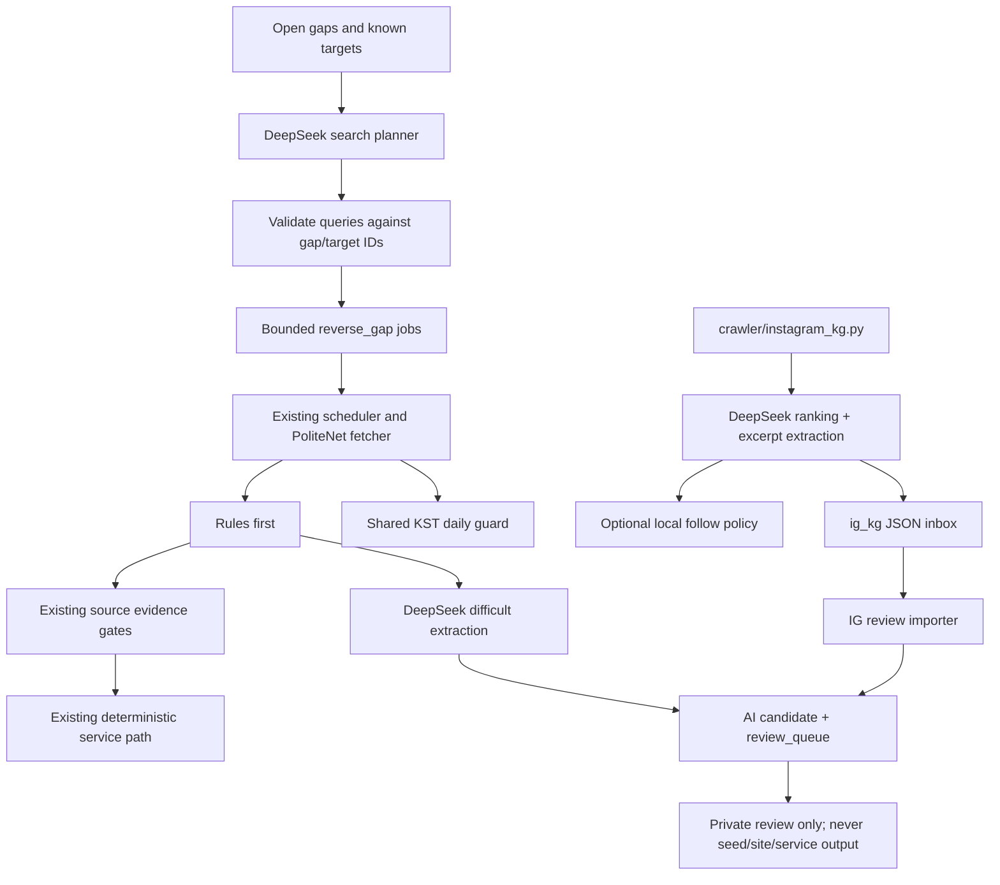

# DeepSeek collection design: web and @kitchen.genome

Status: DESIGN (revision 2, design review). Owner order: 2026-11-05.
Baseline: `main` at `bea455d` (revision 1 of this document); runtime baseline
`8a2326a`. This revision changes only this document. Every module, migration,
configuration, command, and test described below is still proposed
implementation work.

Revision 2 closes gaps found against the owner order:

- names the adapter that imports Instagram findings into `review_queue`;
- defines one durable KST-day allowance and the SQLite tables behind it, shared
  by both web paths and Instagram;
- states clearly that `500`/`200` are enforced daily counters, not just values in
  `crawler/config.json` — today neither web path counts or persists them;
- makes every provenance and publication guard a concrete code boundary;
- specifies the request-level Instagram guard, quota atomics, and crash marker;
- replaces the pipeline's auto-merge/deploy tail with an explicit PR-only,
  `RESULT`/`IG_*` contract;
- removes unverifiable model-catalog claims: the model stays configurable and
  fails closed instead of substituting.

## 1. Scope and invariants

DeepSeek supplies bounded search plans and difficult extractions for web
collection, plus handle ranking, excerpt extraction, and optional follow
recommendations for the dedicated `kitchen.genome` Instagram account. Local
Python daemons perform all acquisition. No Grok Bot chat calls, no Cursor
CloudAgent, and no fallback to another model provider.

### 1.1 Hard limits from the owner order

| Area | Limit |
| --- | --- |
| Web per-domain delay | at least 5 s; a longer robots `Crawl-delay` wins |
| Web per-domain concurrency | 1 |
| Web link depth | at most 2 |
| Web daily candidates | at most 500 distinct admitted candidate URLs per KST day |
| Web daily content requests | at most 200 per KST day |
| Web stops | robots disallow, 403, 429, 503, challenge -> source/domain stop |
| Instagram delay | at least 8 s between **every** network request |
| Instagram handles | at most 25 distinct handles per KST day |
| Instagram captions | at most 6 caption inspections per handle per KST day |
| Instagram excerpt | at most 40 Unicode characters after normalisation |
| Instagram follows | at most 10 follow attempts per KST day |
| Instagram stops | checkpoint, challenge, 2FA/email code, suspicious login, 429 -> account stop |
| DeepSeek calls | non-streamed JSON only; bounded input/output; no automatic retry |

These are ceilings, not targets. An operator override may make a limit stricter;
it may not exceed an owner cap.

### 1.2 Publication invariants

- Every model-derived finding is `asserted_by=ai_inference`, `epistemic=inference`,
  `pending_only=true`, and is visible only in the private review queue. Source
  quality, model confidence, agreement between models, or repetition across
  requests cannot promote it.
- No AI or Instagram record may change `data/seed.json`, service views,
  employment/status history, site output, or `crawler/vault.json`,
  `crawler/out/findings-*.json`, or `crawler/manual_findings.json`.
- Every Instagram finding, including a deterministic keyword match, is
  pending-only and cannot corroborate a publishable web finding. In particular
  it never increases the source count used by `crawler/apply.py`.
- Model output is data, never code: it is parsed as JSON, validated locally, and
  never used to build a fetch URL, edit registry permissions, resolve a gap, or
  promote a host.
- Existing web safety behavior is retained: robots enforcement, domain pauses on
  403/429/503/challenge, at least 5 s per domain, concurrency one, depth two,
  and the 500/200 daily ceilings.
- Instagram uses only its dedicated identity and never reads, copies, or falls
  back to the legacy `agamajung` session, password, or stop flag.
- Work proceeds on a branch and stops at a reviewable PR. Never push to `main`,
  force-push, auto-merge, or auto-deploy from this pipeline.
- Secrets and runtime data stay out of git: `DEEPSEEK_API_KEY`,
  `KITCHENGENOME_IG_PASSWORD`, session files, raw prompts, raw responses, and
  full captions.

## 2. Existing integration points and gaps

| Existing code | Observed behavior | Required design change |
| --- | --- | --- |
| `daemon/kg_daemon/stages.py::extraction` | `env['ai_extractor']` hook exists; it is called for **every** changed document and charges a fixed `1.0` `llm_tokens_k` before the call. Results are `asserted_by='ai_inference'`. | Bind the shared adapter; select only difficult documents; charge measured usage once; create the review row in the same transaction. |
| `daemon/kg_collect/pipeline.py::process_doc` | `model_hook` runs only on rows where `needs_model(r)` is true. `{**r, **alt}` lets model fields overwrite rule fields before `epistemic`/`extractor` are forced. | Validate model fields against the rule row and the supplied text; preserve the rule row; force provenance after validation; queue review immediately. |
| `daemon/kg_collect/cycle.py` | `Bot.model_hook` exists but `kg_collect/cli.py` never supplies it. `run_cycle` uses `cost_cap or bot.units * 1.3`, so an explicit zero becomes the default. `UNIT_COSTS` has no `llm_tokens_k`. | Inject planner/extractor adapters; add `llm_tokens_k`; honour `cost_cap=0`; keep the existing stage/scheduler/fetcher order. |
| `daemon/kg_collect/gaps.py`, `apply.py`, `resolve.py` | Gap filling, application, and promotion require claim/fact evidence. `gap_jobs` emits deterministic `FIELD_QUERIES` and bumps attempts per job. | Retain every gate. Let AI propose queries only; deterministic queries remain the fallback. Explicitly reject model provenance at each boundary. |
| `daemon/kg_daemon/collect_bridge.py` | Reads collector `extraction` rows where `fetch_record.extractor_version = extraction.extractor_version`; the default `_cand` provenance is `source`; candidate idempotency does not include model/prompt version. | Carry AI provenance; compare rule versions and model/prompt/schema versions separately; extend candidate keys with provenance/version. |
| `daemon/kg_daemon/runner.py::CostMeter` | Per-run ledger only. `charge` rejects a call that would exceed the cap and ignores non-positive units, so post-hoc billing, refunds, and durable day accounting are impossible. | Add durable reservation/settlement and a shared KST-day allowance; never write a negative charge. |
| `crawler/crawl.py` | Reads `delay_sec` (global last-request timestamp, not per-domain). `daily_candidate_url_limit` and `daily_content_fetch_limit` exist in `crawler/config.json` but are **not counted or enforced**. 403/429/503 are only counted as errors; no persisted domain pause. | Either route daily web work through `kg_collect`, or add the same shared daily guard and domain-pause behavior here. Preserve the existing `findings-YYYYMMDD.json` contract. |
| `daemon/kg_collect/net.py::PoliteNet` | Correct robots, per-domain delay, concurrency, banned hosts, and in-process `paused_hosts`. Pauses are not persisted between processes; no daily counters. | Persist domain pause state; feed every request through the shared daily guard. |
| `crawler/instagram.py` | Legacy `agamajung` identity/session/flag; delay before each profile; post loop checks `j >= 6` **after** pulling the next post, so it can fetch a seventh caption; no request-level guard. | Leave the module and its `ig_blocked.flag` untouched. Build parallel `crawler/instagram_kg.py` with a request-level guard, durable quotas, and bounded iteration. |
| `crawler/apply.py` | Reads `crawler/out/ig-*.json`. `n_src = len(hosts) + (1 if ig and hosts else 0)`: one Instagram finding plus one reliable web host reaches 2 and can auto-apply. | New output lives in `crawler/out/ig_kg/` and never matches the glob. Add defense-in-depth rejection of `pending_only`, `ai_inference`, and `collector_account=kitchen.genome`. |
| `sources/registry.yaml` | `instagram_public` is paused (checkpoint) and points at the legacy adapter. The new account has no entry. | Add `instagram_kitchen_genome`; leave `instagram_public` unchanged. |
| `scripts/daily_pipeline.sh` | Runs legacy IG unconditionally, force-pushes a fresh branch, immediately squash-merges, optionally deploys, and stages with `git add -A`. | Select KG explicitly, emit `IG_*`/`RESULT`, stage a whitelist, and stop at PR creation. |
| `.gitignore` | Already ignores `crawler/out/`, `data_store/`, `*.sqlite*`. Session paths are outside the repo. | Add `*.session` and secret-file patterns as defence against accidental copies. |

The legacy registry describes `instagram_public` as paused. Its flag, session,
and credentials remain untouched. The dedicated account is an owner-ordered
identity change, not a failover: a KG block must never invoke `agamajung`, and a
legacy block must never affect KG.

## 3. Components and data flow



### 3.1 Proposed modules

| Module | Responsibility |
| --- | --- |
| `daemon/kg_ai/__init__.py` | Package marker and version constants. |
| `daemon/kg_ai/deepseek.py` | Thin OpenAI-compatible HTTP client: fixed endpoint, injected transport/clock, bounded JSON, sanitised errors, request identity, usage. No retry, no redirects, no proxy env. |
| `daemon/kg_ai/contracts.py` | Task schemas and validators for `plan_gap_queries`, `extract_facts`, `rank_ig_handles`, `extract_ig_excerpt`, and `decide_follows`. |
| `daemon/kg_ai/budget.py` | Reservation/settlement adapter around `CostMeter`; KST-day allowance; request replay ledger. |
| `daemon/kg_ai/daily_guard.py` | Durable candidate/fetch counters, domain pause persistence, and IG handle/caption/follow quotas. |
| `daemon/kg_collect/deepseek.py` | Web planner and difficult-extraction adapter for `kg_collect`. |
| `daemon/kg_collect/ig_import.py` | Idempotent `ig_kg/YYYYMMDD.json` -> `review_queue` importer. |
| `daemon/kg_daemon/deepseek.py` | Adapter for `stages.py::extraction`; reuses `kg_ai` rather than implementing another client. |
| `crawler/instagram_kg.py` | Dedicated collector with injectable IG transport, clock, sleeper, model client, and persistent account state. |
| `schema/migrations/0006_deepseek_collect.sql` | `llm_request`, `daily_counter`, `ig_account_day`, `ig_handle_day`, and provenance/index support. |
| `docs/data/DEEPSEEK_COLLECT.md` | Operator runbook and rollback (implementation stage). |

Use `PYTHONPATH=daemon` consistently for CLI and crawler entry points.
`kg_collect` owns live web acquisition. `kg_daemon` consumes its records and
local crawler evidence; do not create a second competing web crawler.

### 3.2 State ownership

- The service SQLite DB (`KG_SERVICE_DB`, default
  `data_store/kg_service.db`, git-ignored) is the only durable state for runs,
  costs, quotas, reservations, review items, and account locks.
- `crawler/out/ig_kg/` is a transient, git-ignored inbox. Files are imported
  idempotently and retained only for audit, at most 30 days.
- Raw prompts, raw responses, full captions, and bios are never persisted. Only
  validated findings, usage counts, hashes, and audit metadata are stored.
- If the service DB is absent, AI and IG work is skipped explicitly. Do not
  create or migrate production data from the daily pipeline.

## 4. Shared DeepSeek contract and cost control

### 4.1 Configuration and HTTP

Read `DEEPSEEK_API_KEY` only at runtime. Send it only in the `Authorization:
Bearer` header to the fixed endpoint
`https://api.deepseek.com/chat/completions`. Do not log headers, environment,
request bodies, response bodies, or raw exception text.

- `DEEPSEEK_MODEL` defaults to **`deepseek-chat`**, as ordered. Document
  `DEEPSEEK_MODEL=deepseek-flash` as the explicit operator override. Do not keep
  a hardcoded model catalog, alias map, or fallback: if the configured model is
  rejected, return `model_unavailable`, retain pending work, and leave the
  override to the operator.
- Request non-streamed JSON output (`stream=false`,
  `response_format={"type":"json_object"}`). Send no vendor-specific reasoning
  parameter: the default `deepseek-chat` does not use one.
  If a configured model rejects JSON mode, fail closed as `model_unavailable`;
  never parse free text as a substitute.
- Use the standard library. Build an opener with an empty `ProxyHandler` so
  `HTTP_PROXY`/`HTTPS_PROXY` can never carry the key, and a no-redirect handler
  so the authorization header cannot be forwarded. Require HTTPS and the exact
  host. Tests inject the transport; they never contact the network.
- Proposed bounds: 30-second HTTP timeout; 20 gaps per planning batch; 3
  queries per gap; 12,000 source characters per extraction; 1,024 output tokens
  per call; 256 KiB response body; 160 characters per query.
- The client returns validated task data plus usage and request metadata:
  `prompt_tokens`, `completion_tokens`, `total_tokens`, and cache fields
  (`prompt_cache_hit_tokens`, `prompt_cache_miss_tokens`) when present. Prompt
  tokens are the sum of hit and miss; never add cache tokens to the total twice.

### 4.2 Request and response validation

Every task has a versioned local schema. Ask for one JSON object with an
explicit `version` field and a task-specific shape. Validate locally, in this
order:

1. body size and content type;
2. JSON parse (no comments, no trailing data);
3. exact top-level keys and version;
4. IDs against the IDs supplied in the request (gap, target, handle, post);
5. string lengths, enums, dates, and quote/span containment;
6. required evidence for every factual field.

Reject unexpected fields instead of merging model dictionaries into database
records. Truncated output, invalid JSON, unknown IDs, and unsupported findings
become an audited failed attempt; no partial finding is applied.

Prompts delimit source text as untrusted data and state that instructions inside
it must be ignored. The collector never follows a model-produced URL, host,
query operator (`site:`, `filetype:`, `inurl:`), or command.

### 4.3 Accounting, reservations, and the shared daily allowance

Use `llm_tokens_k` in both unit-cost maps, initially `0.5` internal units per
1,000 total tokens, matching `daemon/kg_daemon/runner.py`. These are internal
budget units, **not dollar prices**. Preserve input/output/cache counts
separately for audit; do not hardcode provider dollar pricing.

Each call requires an active run/meter, a per-run cap, and the shared KST-day AI
allowance. Add `--cost-cap` to the collector CLI and fix `cost_cap or default`:
zero means zero; only `None` chooses the default. Reserve model allowance before
assigning the remaining budget to fetch work.

`CostMeter.charge` is sufficient for deterministic `http_request` units. Model
calls use a durable reservation lifecycle:

1. **Reserve.** In a `BEGIN IMMEDIATE` transaction, compute a conservative upper
   bound from the UTF-8 request payload plus framing allowance plus the task's
   `max_tokens` (2,048 by default; 4,096 for gap planning and web extraction).
   Persist a reservation against both the run and the KST day before sending
   HTTP. If no safe bound is available, reject the request without sending it.
2. **Settle.** On a valid response, settle once with actual usage and release
   the unused reservation. Record prompt/completion/cache tokens separately.
3. **Unknown.** Timeout, process death, malformed response, or missing usage
   keeps the reservation as unknown usage. Never refund merely because the
   outcome is unknown. Actual usage above the reservation is recorded in full
   and stops further calls.
4. **Replay.** The request key includes task, gap/handle snapshot or source
   hash, model, prompt version, and schema version. A completed validated result
   may be reused without another charge. Unknown attempts are not automatically
   resubmitted; every explicitly scheduled new attempt needs a fresh
   reservation.

Add `llm_request` with at least: `request_id`, `request_key` (unique),
`run_id`, `task`, `model`, `prompt_version`, `schema_version`, `state`
(`reserved`/`settled`/`unknown`/`failed`), `reserved_units`,
`prompt_tokens`, `completion_tokens`, `total_tokens`, `cache_hit_tokens`,
`cache_miss_tokens`, `http_status`, `error_code`, `created_at`, `settled_at`.

Add `daily_counter(kst_day, counter_name, used, updated_at, PRIMARY KEY
(kst_day, counter_name))` for `web_candidates`, `web_fetches`,
`ai_units`, `ig_handles`, `ig_captions:<handle>`, and `ig_follows`. Read the KST
day from `Asia/Seoul`, not UTC. Increment inside a transaction before the
corresponding action. Counters never reset on process restart, resume, or a new
`daemon_run`.

IG uses the same run/meter machinery with daemon name `kg-instagram`, a
separate account lock, and the same `ai_units` daily row as web. Mirror collector
task attribution into `budget_ledger` without double-charging `cost_ledger`.

Suggested starting allowance: `KG_AI_DAILY_COST_CAP=60` internal units per KST
day (approximately 120,000 total tokens at the initial scale), shared by web and
IG. The operator may lower it; raising it requires an owner cap change.

### 4.4 Failure taxonomy and replay

No automatic retries inside the client. Return sanitised error codes:
`missing_key`, `disabled`, `auth_failed`, `model_unavailable`, `rate_limited`,
`timeout`, `transport`, `http_5xx`, `invalid_json`, `schema_invalid`,
`truncated`, `response_too_large`, `cap_exceeded`, `unknown_usage`.

- `missing_key` / `disabled`: AI is explicitly off; deterministic web work
  continues; IG may collect bounded keyword leads and reports `ai=disabled`;
  follows stay off.
- `auth_failed`, `model_unavailable`, `invalid_json`: end the model phase for
  that run; do not substitute a provider or model.
- `rate_limited`, `http_5xx`, `timeout`, `transport`: end the model phase; the
  run may still complete deterministic stages.
- `cap_exceeded`: pause model work through the existing cost-cap checkpoint.
- Stage retry wrappers must not replay a failed paid call.

## 5. Web planning, extraction, and review

### 5.1 Gap-driven planning

In `stage_plan`, after `gaps.classify_gaps`:

1. Select up to 20 open, non-`inaccessible`, non-`conflict` gaps using the
   existing `attempts`/`opened_at` ordering.
2. Send only known target IDs/names, field, gap class, failed query history, and
   allowed source classes. Do not send fetched page bodies.
3. Ask for at most 3 queries per gap in the versioned `plan_gap_queries` schema:
   `gap_id`, `target_id`, `query`, `reason`.
4. Validate every ID against the batch, reject URLs and search operators, dedupe
   against the existing `crawl_job.job_id`, and require the query to contain the
   known target name or a known alias.
5. Build URLs only through `discover.search_url` and enqueue only
   `path='reverse_gap'`, preserving parent/depth, relevance floor, queue caps,
   and the reserved discovery share.
6. AI-created jobs share the existing `gaps.gap_jobs(limit=60)` ceiling; they
   do not add a second 60-job allowance. Merge validated AI queries with
   deterministic fallback queries for gaps the model did not cover, dedupe, and
   cap the combined list at 60. If AI is disabled, errors, or returns no valid
   queries, use the existing `FIELD_QUERIES` fallback unchanged.

The model cannot rewrite registry permissions, promote a host, resolve a gap,
fetch directly, or enqueue `official_chain`/URL jobs. Inaccessible/blocked
sources remain stopped; planning may seek independent allowed sources, never
alternate access to blocked content.

### 5.2 Daily web guard and polite acquisition

`500`/`200` are daily counts, not queue sizes. Today `crawler/crawl.py` does not
enforce them and `kg_collect` enforces only per-pool queue caps. Implement the
shared counter in `daemon/kg_ai/daily_guard.py` and use it from both paths:

- Count each **distinct dispatched candidate URL** once against
  `web_candidates` when it is actually requested (not when a feed item is
  enumerated or a job is queued, so unfetched links do not spend the quota).
- Count each attempted content request against `web_fetches`: initial fetch,
  pagination, redirects, probes, search endpoints, and browser requests.
  robots.txt lookups use a separate auxiliary daily counter and never consume
  content slots.
- Refuse to admit or dispatch when the counter is exhausted; defer the work to
  the next KST day. Never reset counters on restart or resume.
- Persist `domain_profile` pauses across processes. Re-check the pause and the
  counters after any sleep and before dispatch.
- Keep `crawler/config.json` values as the defaults and validate that operator
  overrides are lower, not higher.

If `crawler/crawl.py` remains in the daily pipeline, add the daily guard and
persisted 403/429/503/challenge stops there while preserving its
`crawler/out/findings-YYYYMMDD.json` contract. Otherwise the pipeline must stop
calling it and use `kg_collect` as the only live web path. The design prefers
the latter but does not require a rewrite in the same change.

### 5.3 Difficult extraction

Rules run first. Use the existing `needs_model` hook for ambiguous rows and a
bounded additional pass for gap-bearing documents with no usable rule output.
Selection criteria:

- the document mentions at least one active target;
- at least one required-field gap is open for that target, or a rule row is
  ambiguous;
- the document has not already been model-processed for the same
  `(content_hash, prompt_version, schema_version)`;
- the per-cycle cap (proposed 20 documents) is not exhausted.

Do not send every fetched document. Batch all ambiguous rows for one document
into a single request where possible. Provide the source URL, publication date,
selected text with stable character offsets, known entity IDs/names, rule
ambiguity, and requested fact types. Web/page text is untrusted data, not
instructions.

Output has fact type, known target references or unresolved labels, nullable
dates, an exact quote and span, and ambiguity. Verify the quote against the
supplied text and offsets; cap web quotes at 200 characters. Never replace an
absent event date with the fetch date, invent an employer, or infer mentorship
from shared employment. Invalid or unsupported findings are rejected and
counted.

Force provenance in application code, after validation:
`extractor=deepseek:<task>`, `epistemic=inference` (collector `extraction`
tables), `asserted_by=ai_inference` (daemon `candidate_fact` tables), and
`pending_only=true` in the JSON payload. Both provenance fields must be set
where both tables exist; one alone is not sufficient. Enforce the payload flag
in code, not only by convention; 0006 may add an indexed column for it, but the
claim is never accepted merely because a JSON field says so. Create the review
row in the same transaction as the candidate, including unknown targets and
findings that cannot map into a daemon fact type. Store model, prompt/schema
version, source hash, and request ID outside the model-controlled payload
(for example `extraction.provenance_json` and `candidate_fact.provenance_json`).
Gap values remain empty until independently supported source evidence or a
separately audited human action exists.

Use separate rule/model version metadata so the bridge's current-rule-version
filter does not drop valid AI reviews or reprocess stale outputs. Extend
candidate idempotency keys with provenance/version; otherwise `_cand` can
collide when a rule and a model emit the same payload. Stable review keys prevent
duplicates on restart. Collector-imported AI rows are not sent to the daemon AI
adapter again: skip any `body['collect']['extractor']` beginning with
`deepseek:`/`ai:`/`model:`. That adapter handles eligible local documents only.

### 5.4 Publication boundary

Both collector and daemon must queue inference before entity resolution or
application can materialise it. Add one shared predicate, for example
`is_pending_only(record)`, that returns true when any of these holds:
`asserted_by == 'ai_inference'`, `epistemic == 'inference'`,
`pending_only is true`, `collector_account == 'kitchen.genome'`,
`instagram is true` for a KG record, or the extractor starts with
`deepseek:`/`ai:`/`model:`.

Guard every boundary with that predicate:

- `crawler/apply.py`: reject before grouping and before corroboration counting;
  never add IG to `n_src` for an AI group.
- `daemon/kg_collect/gaps.py`, `resolve.py`, `apply.py`, `promote_candidates`:
  never resolve a gap, promote a target, or apply a claim from a model record.
- `daemon/kg_daemon/stages.py`: `entity_resolution` may resolve IDs for review
  display, but `evidence_verification` must assign `ai_inference` and
  `state_history_update` must queue review instead of materialising.
- `service_output_recompute`: never reads candidate/review provenance directly;
  only claims with status `source_claim` or above reach output.

The primary review store is the existing SQLite `review_queue`, linked to
`candidate_fact` by `subject_id`. It is not a public service view. Do not feed
these records into `crawler/vault.json`, `findings-*.json`,
`manual_findings.json`, or seed export. Human review records a separate
decision/evidence trail; it never mutates the original AI assertion to a source
assertion.

## 6. Dedicated Instagram collector

### 6.1 Identity, storage, and scheduling

| Setting | Value |
| --- | --- |
| Entry point | `crawler/instagram_kg.py` |
| Login | `kitchen.genome` (never inferred from a session or seed data) |
| Password environment | `KITCHENGENOME_IG_PASSWORD` |
| Session | `/home/box/.secrets/kg_ig_kitchen_genome.session` |
| Block flag | `crawler/out/ig_kg_blocked.flag` |
| Output inbox | `crawler/out/ig_kg/YYYYMMDD.json` (outside legacy `ig-*.json`) |
| Service DB | `KG_SERVICE_DB`, same DB as web |
| Account lock | `run_lock` row `ig-kg` |
| Source registry key | New `instagram_kitchen_genome`, tier `social_lead`, trust ceiling `unverified` |
| Runtime state | Git-ignored service DB: account/day quotas, last dispatch, crash marker |
| Collection window | Preserve 06:45-08:00 Asia/Seoul; preserve 09:30-10:30 and 20:30-21:30 blackouts |

Validate the saved session's authenticated username exactly. Reuse it when
valid; never fall back to another account. If absent, log in once with the
dedicated environment password, creating the directory with restrictive
permissions and the session mode `0600`. First login for the new account is an
owner-observed action; the collector must not attempt repeated logins. Never
inspect or copy legacy secrets.

Missing `KITCHENGENOME_IG_PASSWORD`/session is `IG_SKIPPED` (not a block).
Invalid session, login failure, or challenge is a durable stop. Check the flag,
window, blackout, and account lock before any network call and again at request
dispatch.

Retain only public restaurant/brand handles from existing seed/target records or
human-reviewed discoveries. Private/personal accounts, follower harvesting, DMs,
comments, images, video, and stories remain out of scope.

### 6.2 Handle selection and DeepSeek ranking

1. Build the eligible set from `data/seed.json` restaurant handles and
   human-reviewed target aliases. Exclude self, private/personal accounts,
   already-blocked or unresolved handles, and anyone outside the allowlist.
2. Ask DeepSeek to rank at most 25 eligible handles against open gaps and recent
   checks. Input contains handle, known target ID/name, gap fields, and last
   check date. Output contains only a known handle, target ID, priority, and a
   short reason.
3. Intersect the response with the local allowlist; a model-provided handle that
   is not already eligible is discarded and counted.
4. Fill missing slots by fair deterministic rotation (least recently checked,
   then stable hash). AI failure never blocks the deterministic rotation.

### 6.3 Request-level guard and quotas

Use a request-level wrapper around the IG client, not just a sleep between
profiles. It covers login/session validation, profile lookups, lazy pagination,
caption metadata, and follows. Disable library retries. Enforce at least 8
seconds between dispatches with a fake-clock-testable scheduler. Persist the
last dispatch time and serialize account access with the `ig-kg` lock.

Re-check the window, blackout, flag, and limits after sleep and before dispatch.
If the dependency cannot expose every request for this guard, it is unsuitable
for this collector.

Reserve quota atomically in `ig_account_day`/`ig_handle_day` before the first
access:

- at most 25 distinct handles per KST day;
- at most 6 caption inspections per handle per KST day;
- completed handles are not re-crawled that day;
- a seventh caption is never fetched (use bounded iteration that asks for at
  most six; do not fetch and then break);
- pagination metadata beyond the cap is discarded without inspecting or
  persisting extra captions;
- progress is resumable and a retry never resets quota.

Before each dispatch, write an `ig_inflight` marker with request type and time.
On startup, an uncleared marker from the same day means activity is uncertain:
record a durable same-day stop and make no further network request. Clear the
marker only after the response is durably recorded.

### 6.4 Extraction, privacy, retention

Profile bios and captions are transient inputs. Apply the existing privacy
filter before model submission and storage, then send only bounded relevant text
to DeepSeek. Persist only:

- a validated excerpt of at most 40 Unicode characters after whitespace and
  normalisation;
- source URL, post date, target/handle, finding type;
- provenance (`instagram=true`, `collector_account=kitchen.genome`,
  `pending_only=true`, plus `ai_inference` for model findings);
- review ID and model/prompt/schema version.

No full captions, bios, prompts, model responses, or media in raw storage or
logs. Revalidate the 40-character limit after normalisation. Retain excerpts for
at most 30 days; purge content from output and review payloads while keeping
non-content audit IDs.

DeepSeek findings are `ai_inference`; deterministic keyword findings remain
social leads. Both are pending-only.

### 6.5 Optional follows

`KG_IG_FOLLOW=0` by default. DeepSeek may return `follow|skip|review`, a known
eligible handle, and a bounded reason. Execution requires an explicitly enabled
follow backend and all local guards; model output alone cannot enable it.

- Prefer public restaurant/brand accounts already checked in the day's 25-handle
  set.
- Exclude self, already-followed, private, and unresolved accounts.
- Reserve at most 10 follow attempts per KST day before dispatch.
- Attempts with uncertain outcomes consume quota and are never replayed.
- No unfollow churn, DMs, comments, likes, or other engagement.
- The read collector's library is not assumed to support following: use an
  injected, tested follow transport. If unavailable, report
  `follows_disabled_backend_unavailable` and leave recommendations pending.

### 6.6 Review import

`crawler/instagram_kg.py` writes only the transient JSON inbox. It contains
excerpts, not full captions, and is retained at most 30 days (purged by the
pipeline or an operator). Illustrative shape:

```json
{
  "account": "kitchen.genome",
  "day": "2026-11-05",
  "status": "ok",
  "handles": [{"handle": "example_restaurant", "target_id": "r_123", "state": "ok"}],
  "findings": [{
    "handle": "example_restaurant", "target_id": "r_123", "kind": "closure",
    "url": "https://www.instagram.com/p/EXAMPLE/", "date": "2026-11-04",
    "excerpt": "이번 주 영업 종료", "excerpt_chars": 9,
    "asserted_by": "ai_inference", "pending_only": true,
    "collector_account": "kitchen.genome", "model": "deepseek-chat",
    "prompt_version": "ig_excerpt/v1", "schema_version": "1",
    "content_hash": "sha256:..."
  }]
}
```

The pipeline then runs:

```text
PYTHONPATH=daemon python3 -m kg_collect.ig_import \
  --db "$KG_SERVICE_DB" --inbox crawler/out/ig_kg/YYYYMMDD.json
```

The importer is idempotent and transaction-scoped:

- one `review_queue` row per validated finding:
  `reason='instagram_ai_inference'` or `'instagram_keyword_lead'`,
  `subject_type='target'` when the target is known and `'instagram_handle'`
  otherwise, `subject_id` set accordingly;
- payload contains only excerpt, post URL/date, handle, target, finding type,
  provenance, model/prompt/schema version, and content hash;
- `dedupe_key` is a stable hash of account + handle + post URL + finding type +
  content hash;
- no `candidate_fact`, `extraction`, `claim`, `employment`, or `service_output`
  row is created;
- re-running the same inbox adds nothing;
- a missing DB reports `IG_SKIPPED reason=missing_db` and leaves the inbox in
  place; an import error is `IG_FAILED` but does not delete findings.

Do not add `crawler/out/ig_kg/` to `stages.py::_instagram_records`, the legacy
`ig-*.json` glob, or `crawler/apply.py`. The importer is the only consumer, so
KG findings can never enter a materialisation or corroboration path.

### 6.7 Stop behavior

Checkpoint, challenge, 429, suspicious login, 2FA/email-code request, invalid
session, or access denial ends **all** KG network activity immediately.

- Atomically persist partial pending findings and the flag with a timestamp and
  a sanitised reason enum.
- The flag prevents subsequent logins, crawls, and follows until a human checks
  the account and clears it; day rollover does not clear it.
- Preserve a same-day stop marker so clearing a flag does not silently retry
  that day.
- Transport uncertainty also stops the current run conservatively and writes
  the crash/uncertainty marker.
- A blocked KG flag does not switch the run over to `agamajung`. The legacy
  `ig_blocked.flag` also skips KG before any request, whichever account it was
  written for. Neither flag is deleted to make the other account usable.
- No proxy, account swap, challenge solving, or automatic same-day relogin.
- No automated notifications to other accounts; emit one operator-visible
  `IG_BLOCKED` line with a sanitised reason.

## 7. Daily pipeline wiring and observable results

### 7.1 Order

Run inside one pipeline lock, with each stage independently bounded:

1. **Preflight.** Resolve the repo and DB; verify no secret is printed; verify
   git is clean apart from ignored runtime paths. Create a unique branch from
   up-to-date `main`; never delete or reuse a branch that contains work and never
   force-push.
2. **Deterministic web crawl.** Run the existing web path under the shared daily
   guard and polite rules.
3. **`kg_collect cycle`.** Inject the DeepSeek planner/extractor, `--cost-cap`,
   and the shared daily allowance. Preserve stage order and source gates.
4. **`instagram_kg.py`.** Run with its own timeout and the `ig-kg` lock, then
   import the inbox into review storage. Daily selection is KG only; the legacy
   IG script is never an automatic fallback.
5. **`kg_daemon run`.** Pass `--collect-db` and the DeepSeek stage adapter; AI
   provenance is preserved and collector-imported AI rows are excluded from a
   duplicate model pass. A missing service DB skips AI/IG work explicitly.
6. **Deterministic apply/build guards.** Run existing `crawler/apply.py`,
   enrichment, and `scripts/build_deploy.py`; AI/IG review work cannot alter
   seed/site/service outputs.
7. **Stage and PR.** Stage only reviewed artifact paths. If publishable files
   changed, commit, push the branch, create a PR against `main`, and stop. There
   is no merge or deploy in this pipeline.
8. **Final summary.** Emit exactly one `RESULT` line on every controlled exit.

Ignored runtime output, session files, and credentials must never be staged.
`git add -A` is replaced by an explicit path whitelist such as `data/seed.json`,
`crawler/pending.json`, `crawler/applied.json`, `web/`, `scripts/`, `.gitignore`,
and any reviewed registry file. `crawler/out/` and `data_store/` stay ignored.

### 7.2 Environment controls

| Variable | Default | Behavior |
| --- | --- | --- |
| `KG_DEEPSEEK` | `1` | `0` disables all model calls without disabling deterministic work. |
| `DEEPSEEK_API_KEY` | unset | Required for AI; read at runtime and never printed. |
| `DEEPSEEK_MODEL` | `deepseek-chat` | Operator may set `deepseek-flash`; no fallback. |
| `KG_AI_DAILY_COST_CAP` | `60` | Shared KST-day internal units; operator may lower. |
| `KG_COLLECT` | `1` | Keep existing disable switch. |
| `KG_COLLECT_UNITS` | `60` | Keep existing per-cycle work budget. |
| `KG_COLLECT_COST_CAP` | `units * 1.3` | Pass explicitly; `0` means zero. |
| `KG_IG` | `1` | `0` disables the KG Instagram invocation. |
| `KG_IG_FOLLOW` | `0` | Follow execution stays off unless explicitly enabled with a backend. |
| `KG_IG_TIMEOUT` | `900` | Hard timeout for the IG stage. |
| `KG_SERVICE_DB` | `data_store/kg_service.db` | Shared DB for web, IG, review, quotas. |
| `KG_WEB_DAILY_CANDIDATES` | `500` | Lower-only override of the daily candidate ceiling. |
| `KG_WEB_DAILY_FETCHES` | `200` | Lower-only override of the daily content-request ceiling. |

All numerical safety overrides are validated to be stricter than the owner caps.
Shell must not use `set -x`, interpolate secrets into command arguments, or
discard all diagnostic information. Parse sanitised structured summaries,
preserving exit status separately from output parsing; a timeout must not be
reported as success.

### 7.3 Output contract

Emit one terminal `IG_*` line per IG invocation and exactly one final `RESULT`
line. Values below are illustrative.

```text
COLLECT=succeeded run=<id> ai=enabled pending=4 tokens_in=1200 tokens_out=300 cost=12.75
COLLECT=paused_cost_cap run=<id> ai=paused pending=2
COLLECT=skipped reason=missing_db
COLLECT=disabled reason=KG_COLLECT=0
COLLECT=failed stage=extract reason=schema_invalid
IG_OK account=kitchen.genome handles=12 findings=3 follows=0 ai=enabled tokens_in=800 tokens_out=120 pending_only=3
IG_OK account=kitchen.genome handles=12 findings=3 follows=0 ai=disabled reason=missing_key pending_only=3
IG_SKIPPED account=kitchen.genome reason=outside_window
IG_SKIPPED account=kitchen.genome reason=missing_password
IG_SKIPPED account=kitchen.genome reason=missing_db
IG_SKIPPED account=kitchen.genome reason=locked
IG_BLOCKED account=kitchen.genome reason=checkpoint flag=crawler/out/ig_kg_blocked.flag
IG_FAILED account=kitchen.genome reason=timeout
RESULT=NO_CHANGE review_pending=7 collect=succeeded ig=ok
RESULT=PR_CREATED pr=<url> review_pending=7 collect=succeeded ig=blocked
RESULT=FAILED stage=build reason=guard_failed
```

Collection, AI, and IG failures are non-fatal to independent deterministic work
but are always visible in the final summary. `RESULT=FAILED` is reserved for a
blocking guard, an unhandled pipeline error, or a failure to create the promised
PR. Private review data is not included in public PR descriptions.

### 7.4 Exit and recovery semantics

- Exit 0 for `RESULT=NO_CHANGE` and `RESULT=PR_CREATED`.
- Exit non-zero for `RESULT=FAILED`.
- A stage timeout records its own failure line and cannot masquerade as success.
- A KG block or an uncertain IG timeout writes a durable stop before the next
  run can dispatch.
- A locked run reports the lock and exits without touching state.
- Rollback disables `KG_DEEPSEEK`/`KG_IG`; it preserves queues, cost
  reservations, sessions, and stop flags, and never activates the legacy
  account.

## 8. Implementation validation and rollout

### 8.1 Test matrix

Future implementation tests use injected DeepSeek HTTP/IG transports, temporary
SQLite databases, fake clocks, and synthetic secrets. CI denies external network
access, never reads `/home/box/.secrets`, and does not require live credentials.
Run tests with `DEEPSEEK_API_KEY` and `KITCHENGENOME_IG_PASSWORD` unset and
assert that no socket is opened.

| Test area | Required evidence |
| --- | --- |
| Client | Endpoint/auth construction with a dummy key; fixed host; no proxy/redirect; JSON/schema/size limits; sanitised errors; missing key, invalid model, 401/429/5xx, timeout, and invalid usage; no provider fallback; secret never logged. |
| Contracts | Each task schema rejects unknown fields, bad IDs, overlong strings, invalid dates, and quotes/spans not present in the source; truncated output applies nothing. |
| Meter | Actual tokens charged once; zero-cap sends nothing; reservation/settlement; lost response and process death keep the reservation; an over-reservation is recorded and stops further calls; shared daily cap survives new run IDs and concurrent processes. |
| Daily guard | 500/200 counted across restarts and resumed runs; candidate vs fetch counters distinct; per-domain pause persists between processes; delay and depth unchanged; `crawler/crawl.py` and `kg_collect` share the same counters. |
| Planning | Only existing gap/target IDs; bounded queries, dedupe, pool reserve, depth 2; malicious text cannot change permissions, add URL operators, or dispatch URLs; deterministic fallback still works. |
| Extraction | Difficult rows and relevant zero-rule documents; valid quotes/spans; dates remain unknown when absent; version-aware replay; no duplicate daemon AI call; per-cycle document cap. |
| Review isolation | AI from an official host and two agreeing model sources still only queue; no gap fill, target promotion, materialised claim/history, or service change; bridge preserves provenance on collisions. |
| IG identity/quota | Exact KG identity/session/flag; legacy session/flag untouched; request-level delay including lazy pagination, login, and follows; restart and concurrency enforce 25/6/10; seventh caption never fetched; 40-character excerpts and 30-day retention. |
| IG stops | Challenge or 429 on each request type prevents every later request; partial results survive; block survives midnight; crash marker prevents replay; no account/proxy fallback; uncertain follows not replayed. |
| IG import | JSON inbox maps to `review_queue` only; dedupe on re-run; unknown targets retained; missing DB is a clean skip; delete nothing on import failure. |
| Publication | KG finding plus one reliable web source cannot auto-apply; model provenance with forged claim fields remains pending; seed/service/site snapshots unchanged after AI/IG-only run; `crawler/apply.py` rejects pending-only records. |
| Shell | `bash -n`; stub all subprocesses including git/gh/build/collectors; exact statuses for success/skip/block/cap/timeout; PR-only path; no main push, merge, deploy, force-push, or secret output. |

Add `test_deepseek_client.py`, `test_deepseek_budget.py`,
`test_deepseek_web.py`, `test_daemon_deepseek.py`, `test_instagram_kg.py`,
`test_ig_import.py`, and `test_provenance_guards.py`, and extend the existing
daemon, collection, source-registry, and daily-wiring tests. Existing legacy
Instagram tests remain intact.

### 8.2 Schema and configuration changes

Add `schema/migrations/0006_deepseek_collect.sql` with:

- `llm_request` (durable reservation/settlement and replay identity);
- `daily_counter` (KST-day candidate/fetch/AI/IG counters);
- `ig_account_day` and `ig_handle_day` (account and per-handle quotas, last
  dispatch, stop marker);
- `extraction.provenance_json` and `candidate_fact.provenance_json` (or an
  equivalent side table) so model/prompt/schema versions are never stored in a
  rule-version field;
- indexes needed by the planner, review importer, and quota checks.

If IG records a `daemon_run`, also extend its status vocabulary (for example
`blocked`/`skipped`) and avoid reusing `stage_checkpoint` unless its
daemon-stage `CHECK` constraint is widened in 0006. A simpler option is for
`instagram_kg.py` to use `run_lock`, `cost_ledger`, `llm_request`, and the quota
tables directly without a staged `daemon_run`.

Do not edit an applied migration; the migration runner checksums them. Extend
`daemon/kg_collect/UNIT_COSTS` and `daemon/kg_daemon/runner.DEFAULT_CONFIG`
carefully, preserving existing unit meanings.

### 8.3 Implementation order

1. Shared client, contracts, budget/reservations, daily guard, and migration.
2. Web planner/extractor adapters, provenance guards, and the `crawler/apply.py`
   defense.
3. Dedicated IG collector, quota/stop state, and review importer.
4. Daily pipeline wiring, operator docs, and the PR-only tail.
5. Fixture-only validation, then an explicitly configured bounded runtime trial
   outside CI.

Optional following stays disabled until its transport passes the same stop and
quota tests.

### 8.4 Rollback

Set `KG_DEEPSEEK=0` and `KG_IG=0`. This stops model and Instagram activity while
leaving deterministic web work, queues, reservations, sessions, and stop flags
intact. Never "roll back" by activating the legacy account or by deleting
`review_queue`/`llm_request` audit rows.

### 8.5 Owner confirmations (non-blocking defaults chosen)

- Confirm the starting `KG_AI_DAILY_COST_CAP` (proposed 60 internal units/day).
- Confirm that the legacy `agamajung` IG step is removed from the daily pipeline
  while the script and its flag remain available separately.
- Confirm that the first `kitchen.genome` login is owner-observed.
- Confirm that the pipeline stops at a PR and no longer auto-merges or deploys.
- Confirm `deepseek-flash` is the intended override model name.

## 9. Revision history

- 2026-11-05 rev 1: initial design after the owner order; documentation only.
- 2026-11-05 rev 2: design review. Added the IG review importer, durable daily
  allowance and reservation schema, explicit web daily counters, code-level
  provenance predicates, request-level IG guard/crash marker, PR-only pipeline
  contract, and fail-closed model handling. Clarified that 500/200 are not
  currently enforced and that `crawler/crawl.py` needs either the shared guard or
  removal from the daily path. No runtime code, tests, configuration, or secrets
  changed in this revision.


## BUILD notes

The shared client and reservation adapter live in `daemon/kg_ai/`. Migration
`0006_deepseek_collection.sql` adds private accounting/quota/provenance state.
`kg_collect` wires gap planning and difficult extraction; `kg_daemon` reuses
the contract for eligible local documents and preserves bridge provenance.
The dedicated IG collector writes directly to the private review queue; its
explicit account provenance never enters generic social-tier routing.
The daily pipeline opens PRs and stops before merge/deploy.

Live browser fallback and automatic redirects are disabled because their
subrequests were outside the durable dispatch guard. This conservative
implementation leaves those pages as coverage gaps. The read-only IG backend
does not execute follows; only an explicitly injected guarded follow transport
can do so. Unknown/failed model attempts are not automatically rescheduled.
Thirty-day IG cleanup also clears cached model excerpts while retaining audit IDs.
